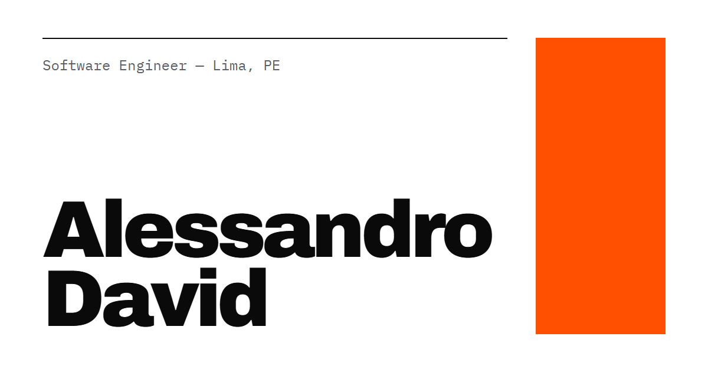

# Alessandro David — Portfolio

Personal portfolio of **Alessandro Alonso David Polanco**, Software Engineer (backend-first: Python, FastAPI, SQLAlchemy, SQL Server, Docker; also React / Next.js / Angular).

**Live:** https://alessandro-david.netlify.app

A bilingual (EN / ES) static site with light and dark themes, built from a fixed Swiss-style design. The code is part of the portfolio, so it is meant to be read.



## Stack

- **Next.js 16** (App Router) with **static export** (`output: 'export'`): no server and no API routes
- **TypeScript** in strict mode (`noUncheckedIndexedAccess` on)
- **Tailwind CSS 4**, mapped to CSS design tokens. The default palette, radii and shadows are removed, so only the tokens can be used
- **Archivo** and **IBM Plex Mono** via `next/font` (self-hosted)
- **Biome** for linting and formatting; **Vitest** + **Testing Library** for tests
- **pnpm**; deployed on **Netlify**; CI on **GitHub Actions**

No UI, i18n or theme libraries. React and Next.js are the only runtime dependencies.

## Getting started

Requires Node 24+ and pnpm (`npm i -g pnpm`).

```bash
pnpm install
pnpm dev          # http://localhost:3000 → redirects to /en or /es
```

| Command | What it does |
|---|---|
| `pnpm dev` | Dev server with hot reload |
| `pnpm build` | Static export to `out/` |
| `pnpm preview` | Serves `out/` locally, as Netlify would |
| `pnpm test` | Vitest, run once (`pnpm test:watch` to watch) |
| `pnpm lint` | Biome lint + format check (`pnpm format` to fix) |
| `pnpm typecheck` | Generates route types, then `tsc --noEmit` |
| `pnpm assets` | Re-renders the OG image and favicons with headless Chrome |

## Routes

| Path | Page |
|---|---|
| `/` | Redirects to `/es` when `navigator.language` starts with `es`, else to `/en`. Without JS it shows a link to each language |
| `/en`, `/es` | Home |
| `/en/projects/genairator`, `/es/projects/genairator` | GenAIrator case study |
| anything else | Styled 404 |

Also generated: `sitemap.xml`, `robots.txt`, `og.png`, `favicon.ico`, `icon.png` and `apple-icon.png`.

## Project structure

```
src/
  app/
    (root)/              `/`: language redirect (its own root layout)
    [locale]/            /en and /es root layout, home, projects/[slug] case studies
    global-not-found.tsx 404 for every unmatched URL
    sitemap.ts, robots.ts, favicon.ico, icon.png, apple-icon.png
    globals.css          design tokens + Tailwind theme mapping
  components/            Server Components; only ThemeToggle and ProjectExplorer run on the client
  config/site.ts         email, GitHub, LinkedIn, paper, CV per locale, public URL
  content/
    projects.ts          every project shown on the home page
    case-studies.ts      case study copy (EN/ES)
  i18n/                  Dictionary type + en.ts / es.ts
  lib/                   filter logic, metadata, JSON-LD, theme and redirect scripts
scripts/                 brand asset sources (HTML) and their renderer
design-reference/        the approved design (source of truth for layout and sizes)
```

## Editing content

### Text

All UI copy lives in `src/i18n/en.ts` and `src/i18n/es.ts`. Both are typed as `Dictionary` (`src/i18n/types.ts`), so a key that is missing or extra in either file is a TypeScript error.

### Add a project, or its repo or demo

Edit `src/content/projects.ts`. Components never need to change.

```ts
{
  slug: 'my-project',            // unique (a test checks it)
  number: '05',                  // order on the home page
  name: 'My Project',
  featured: false,               // true shows the orange thesis tag
  languages: ['python', 'sql'],  // drives the filter and its counts
  languagesLabel: 'Python · SQL',
  description: { en: '…', es: '…' },
  repoUrl: 'https://github.com/Alesso2805/my-project',  // optional
  demoUrl: 'https://…',          // optional
  caseStudySlug: 'my-project',   // optional
}
```

A row links to its case study if it has `caseStudySlug`, otherwise to `repoUrl`, otherwise it is not a link. The filter languages are `python`, `ts`, `csharp` and `sql`. The tools line under the filter is in `toolbelt` in the same file.

### Add a case study

1. Add an entry to `src/content/case-studies.ts` with the same `slug` as the project's `caseStudySlug`, and its copy in both `en` and `es`. Both must have the same shape; a test checks it.
2. That's it: `/[locale]/projects/<slug>` is generated from that list, and a test fails if any `caseStudySlug` has no page.

The optional fields hide their block while they are empty:

| Field | When empty |
|---|---|
| `role` | the "Role" metadata column is hidden |
| `problemBody` | only the big problem sentence is shown |
| `screenshot` | the 16:9 media box is hidden |

`screenshot` takes `{ kind: 'image' | 'video', src, alt: { en, es } }`, with the file in `public/` (e.g. `public/case-studies/genairator.png` → `src: '/case-studies/genairator.png'`).

### CVs

Put the PDFs in `public/cv/`. The file each language downloads is set in `src/config/site.ts`:

```ts
cv: {
  en: '/cv/CV_Alessandro_David_Polanco_International_Remote.pdf',
  es: '/cv/CV_Alessandro_David_Polanco_Espana_Remoto.pdf', // or …_Peru_Remoto.pdf
},
```

### Contact links and paper

Also in `src/config/site.ts`: email, GitHub, LinkedIn, and the paper URL and title.

### OG image and favicon

The sources are `scripts/assets/og.html` and `scripts/assets/icon.html`. After editing them, run `pnpm assets`; it needs Google Chrome, or set `CHROME_PATH`.

## How it works

- **Theme.** `data-theme` on `<html>` switches the CSS variables. A small inline script in `<head>` applies the stored choice, or the system preference, before first paint, so the page never flashes. The toggle stores the choice in `localStorage`; until then the site follows OS changes live. Without JS, a `prefers-color-scheme` media query takes over.
- **i18n.** `/[locale]` is a root layout, so `<html lang>` is correct in the static HTML. Each page has a canonical URL plus `hreflang` alternates (in the `<head>` and in the sitemap). EN|ES are plain links to the same page in the other language.
- **Project filter.** `ProjectExplorer` is the only stateful component. The filter is mirrored in `?stack=` (e.g. `/en?stack=python`) so a filtered view can be shared. The HTML is prerendered with every project visible, so the list also works without JS.
- **Client JavaScript** is limited to the filter, the theme toggle and the `/` redirect. Everything else is a Server Component rendered at build time.
- **Netlify head comment.** On `*.netlify.app`, Netlify injects an HTML comment into `<head>`. React counts it as a hydration mismatch (error #418), re-renders the whole document on the client and drops the theme. A tiny inline script (`src/lib/head-cleanup.ts`) removes comment and blank nodes from `<head>` before hydration.

## Quality

- **Accessibility (WCAG 2.1 AA).**
  - Skip link; one `h1` per page; correct heading order.
  - Real `<button>`s with `aria-pressed` for the filter; `aria-current` on the active language.
  - The theme toggle's `aria-label` describes its action; decorative SVGs and arrows are `aria-hidden`.
  - Visible focus outline; `prefers-reduced-motion` respected.
  - Every text/background pair in both themes is ≥ 4.5:1; the lowest is `--hover` on white, at 5.83:1.
- **Lighthouse (mobile, live site).** On `/en`, `/es` and both case studies: Performance 95–98, Accessibility 100, Best Practices 100, SEO 100.
- **SEO.** Per-locale title, description, Open Graph and Twitter cards; `sitemap.xml` with language alternates; `robots.txt`; JSON-LD `Person` (with `sameAs` to GitHub and LinkedIn) and `ScholarlyArticle` for the IEEE paper.
- **Tests.** The suite checks that:
  - EN and ES dictionaries have identical keys;
  - the filter returns the right projects and counts for every language;
  - project slugs are unique;
  - every `caseStudySlug` has a page, and case-study copy has the same shape in both languages;
  - optional case-study blocks hide when empty;
  - the filter syncs with the URL;
  - the theme toggle and head script, and the `/` redirect, behave correctly.
- **CI.** `.github/workflows/ci.yml` runs lint, typecheck, test and build on every push to `main` and on every PR.

## Deploy (Netlify)

`netlify.toml` builds with `pnpm build` and publishes `out/` on Node 24. It also sets long-term caching for hashed assets in `/_next/static/*` and basic security headers.

- **Site:** `alessandro-david` on Netlify, at https://alessandro-david.netlify.app.
- **Continuous deployment.** Link the GitHub repo once in the Netlify UI (Project configuration → Build & deploy → Continuous deployment → Link repository). After that, every push to `main` deploys. Until then, deploys are manual.
- **Site URL.** Canonical, `hreflang`, Open Graph and sitemap URLs come from Netlify's built-in `URL` variable. With a custom domain, set `NEXT_PUBLIC_SITE_URL` (e.g. `https://alessandrodavid.dev`) in the site's environment variables.

## Design decisions

The design in `design-reference/` is the source of truth. Where the build had to differ, it was agreed first:

- **Hero H1** minimum size is **58px** instead of 64px, so "Alessandro" fits a 360px screen without horizontal scroll.
- **The EN|ES switch** uses links (with `aria-current`) instead of buttons, so it works without JS and is crawlable.
- **Weight 700.** The design uses `font-weight: 700` in a few places but does not load it, so the browser renders those at 800. Loaded weights match the reference exactly: 400, 500, 600, 800 and 900.

## Pending

- [ ] `repoUrl` and `demoUrl` for **Vigía**, **VeriLedger API** and **SentinelAPI** (their rows are not links until then)
- [ ] Where to show `demoUrl` (the design has no slot for it yet)
- [ ] GenAIrator `repoUrl`; "View the code" points to the GitHub profile until then
- [ ] Case study: **role**, **problem paragraph** (`problemBody`) and **screenshot / video**
- [ ] Confirm the exact **paper title** and its **DOI** (then add the DOI to the `ScholarlyArticle` JSON-LD)
- [ ] Upload the **CV PDFs** to `public/cv/` and choose `Espana_Remoto` or `Peru_Remoto` for ES
- [ ] Final **domain**: set `NEXT_PUBLIC_SITE_URL` if it is not the Netlify URL
- [ ] Link the GitHub repo in Netlify for continuous deployment (see *Deploy*)
- [ ] Re-check with PageSpeed Insights (the anonymous API quota was exhausted when the site was first measured)
